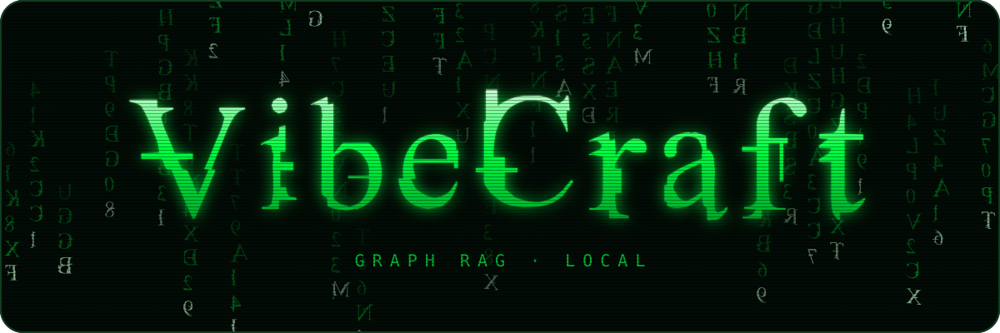
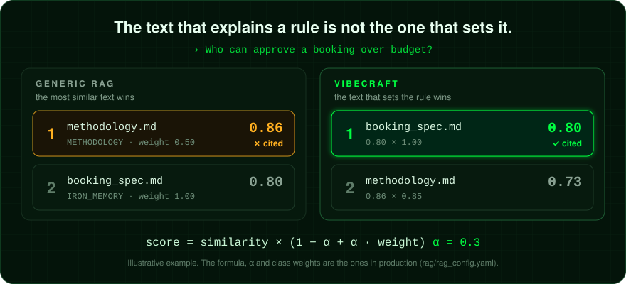
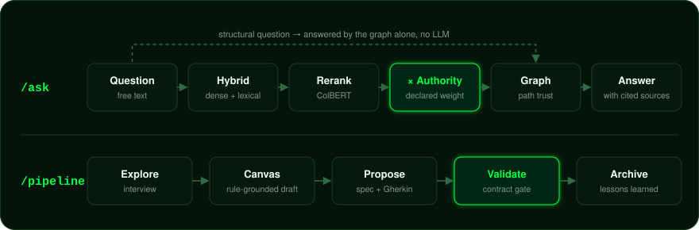
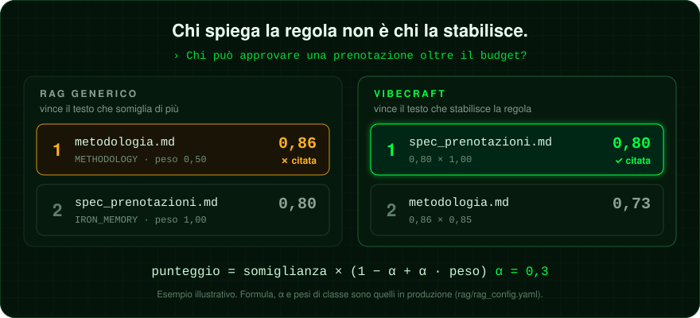
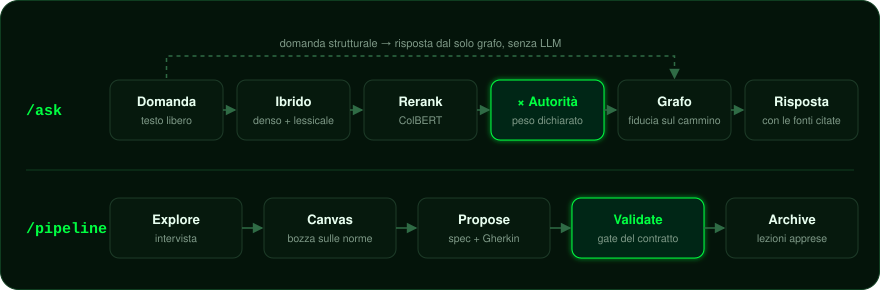

<p align="center">
  
</p>

<p align="center">
  <a href="https://github.com/Silver1V8/VibeCraft/releases"></a>
  <a href="LICENSE"></a>
  
  
  
  <a href="https://github.com/Silver1V8/VibeCraft/pkgs/container/vibecraft"></a>
</p>

<p align="center">
  <sub>Click a language to open or close it &middot; Clicca sulla lingua per aprirla o chiuderla</sub>
</p>

<a name="english"></a>
<details open>
<summary><b>English</b></summary>

<p align="center">
  <em>Cites the rule that applies, not the text that sounds most like your question.</em>
</p>

<p align="center">
  
</p>

<p align="center">
  <strong>Adversarial cases right at rank 1: from 0 of 5 to 5 of 5.</strong><br>
  <strong>recall@1 0.690 → 0.741 &middot; recall@10 0.983 → 1.000</strong><br>
  <sub>Same system with authority nearly off (α 0.1) and calibrated (α 0.3), 58-case golden set, 7 September 2026 (S11): adversarial 0 → 4 of 5; held out, at k=1: +0.038, positive on 5 seeds out of 5. The fifth on 30 October, with a corpus fix. <a href="#numbers">Details</a>.</sub>
</p>

---

You know it. The methodology note: well written, discursive, full of the right words. It explains the rule better than the document that set it. And that is exactly why an ordinary RAG cites it instead of the rule.

**VibeCraft knows who is in charge.** It is a Graph-RAG console for document governance: it indexes normative documents and the code that should implement them, and when it answers it weighs how authoritative each source is, which one prevails when two contradict each other, and how far to trust the graph path that led there.

Everything runs locally by default: your documents leave the machine only if you pick a cloud model in the console's Settings.

## Numbers

The golden set contains **adversarial** cases, built on purpose: in each one a low-authority source (a methodology note, an unclassified historical file) is closer to the question than the rule that answers it. Each one is verified by running the query. They are the test a generic RAG fails by design.

| 58 cases | recall@1 | recall@2 | recall@5 | recall@10 | adversarial at rank 1 |
|---|---|---|---|---|---|
| Authority nearly off (α 0.1), 7 September 2026 | 0.690 | 0.862 | 0.948 | 0.983 | 0 of 5 |
| Authority calibrated (α 0.3), 7 September 2026 | 0.741 | 0.862 | 0.966 | 1.000 | 4 of 5 |
| **In production (α 0.3), 30 October 2026** | **0.724** | **0.828** | **0.948** | **0.983** | **5 of 5** |

The first two rows are the S11 comparison: same corpus, only α changes. The third is the current corpus. The fifth adversarial case was lost because the rule wrote its chunk limit only as a placeholder, while the methodology note spelled out the number: fixed in the corpus (the rule now states its default, the note cites the rules it explains), not in the ranking. The other recalls differ from September because the corpus has changed since, not the weights.

Source attribution has an automatic judge since 30 October 2026: `claude-opus-5-5` agrees with the human verdict on all 24 archived answers, including the 7 wrong ones (R29). It is optional and, like any cloud model, sends those answers to the provider.

α was not picked by gut feeling: a joint grid of 2,160 points, 5-fold × 5 seeds, with the winner confirmed held out. And sometimes the measurement said no: full multiplication (α 1), the one the governing rule prescribed, cost 15 points of recall@5. The rule was amended, not the numbers. Full story in [ADR 0002](rag/adr/0002-autorita-dichiarata-e-fiducia-sul-cammino.md) (Italian) and in the `authority:` block of [rag_config.yaml](rag/rag_config.yaml).

**Answers are grounded in sources, not guaranteed.** Citations, partial results, and open points still need checking, and retrieval does not promise it found everything the corpus contains.

## How it works

<p align="center">
  
</p>

- **Declared authority.** Every document declares its class and weight in its frontmatter. The weight goes into the ranking formula, not just the UI. Freshness is not authority: a recent date makes nobody win.
- **Precedence.** When two documents contradict each other, the one named by the precedence declaration wins.
- **Path trust.** Every graph edge has a nature (structural, curated, inferred), and a source reached through a fragile path counts for less.
- **The graph answers on its own.** "What relationships does X have", "what is impacted if I change Y": answered from the graph, without calling the LLM.
- **From question to change.** The pipeline takes a change from interview to a spec with Gherkin scenarios. The agent starts in agentic mode only after the current contract has passed validation.

## What's inside

| | |
|---|---|
| **`/ask`** | hybrid retrieval (dense + lexical + ColBERT rerank) re-weighted by authority, plus the code that implements the retrieved sections |
| **Pipeline** | Explore → Canvas → Propose → Validate → Archive, grounded in normative documents; the canvas learns from archived reviews |
| **Intake & Import** | local conversion with preview and staging review: Docling for PDF, Excel read directly, MarkItDown, LibreOffice for DOC/PPT |
| **Maps** | graph map, Semantic Map, and Impact Ripple over the corpus and the indexed code, from the rule to the backend endpoint to the frontend page that calls it |
| **Projects** | separate projects with their own folders, indexes, and Qdrant namespaces |
| **Agents** | Claude Code and Ollama built in; Codex and Cursor via prompt export and external MCP |
| **MCP** | read-only local server: retrieval, code search, graph queries |
| **Index** | blue/green versions, eval gate before promotion, verified rollback, copy-on-write delta |

## Who it is for, and who it is not for

| It fits if | It does not fit if |
|---|---|
| the corpus is normative and layered, and the answer lives across documents that may contradict each other | the documents are few and everyone already knows them |
| you need a **verifiable** answer, with the source and the weight that made it win | you need a fast conversational assistant |
| data must not leave the machine | an external service is fine |

On `/ask` it keeps a short per-project thread with accumulated citations: it is not a general chatbot. It does not query several projects together and has no per-user permissions. It is meant to run locally or on a controlled network.

## Quick start

With Docker, from the repository root:

```bash
git clone https://github.com/Silver1V8/VibeCraft.git
cd VibeCraft

# The API key is required in Docker. If .env already exists, add only the variable.
docker run --rm python:3.14-slim python -c "import secrets; print('VIBECRAFT_API_KEY=' + secrets.token_urlsafe(32))" > .env

docker compose --profile cpu up -d qdrant ollama
docker compose exec ollama ollama pull qwen3.5:9b      # 6.6 GB, once
# The variant the config uses: same weights without the vision projector, nothing to download
docker compose exec ollama sh -c "ollama show --modelfile qwen3.5:9b | awk '/^FROM/ && ++n==2 {next} 1' > /tmp/qwen-text.Modelfile && ollama create qwen3.5:9b-text -f /tmp/qwen-text.Modelfile"
docker compose --profile cpu up -d
```

Then open **http://127.0.0.1:8000**. The console asks for the key on first visit and remembers it in that browser.

You do not need your own documents to try it: the initial project already contains a [governance baseline](templates/docs/README.en.md) ready to index.

```bash
docker compose --profile cpu run --rm app-cpu python index.py   # downloads bge-m3, 4.3 GB
```

NVIDIA GPU, Ollama on the host, native install, the ready-made GHCR image, updates, and migrations: **[INSTALL.en.md](INSTALL.en.md)**. If something does not start, `uv run python scripts/doctor.py` from `rag/` checks everything and prints the fix for each problem.

## Requirements, without sugarcoating

| | |
|---|---|
| Download | about **11 GB**: `bge-m3` 4.3 GB + `qwen3.5:9b` 6.6 GB, plus the Docling models for PDF |
| Recommended disk | ~20 GB |
| NVIDIA GPU | optional, but it changes a lot: embedding at 46 chunks/s versus **1 chunk/s** on CPU. A full reindex unloads the local LLM to make room, and it reloads on the next question |
| Full indexing (612 items) | ~13 s with a GPU, **~10 min** on CPU |

Without a GPU everything works. Reindexing becomes something to do calmly, but questions stay usable: query embedding costs about a second, inside the ~30 s the local LLM needs to answer anyway.

## Security

- Listens on **`127.0.0.1`** by default: reachable only from this machine.
- If you expose it on a network, set `VIBECRAFT_API_KEY`: features that only make sense locally switch themselves off, and the key protects the rest.
- `Host` header checked against DNS rebinding, no iframes, Content-Security-Policy with no inline scripts.
- Every HTTP route and MCP tool is mapped in [SECURITY_SURFACE.md](rag/SECURITY_SURFACE.md).

## Documentation

| | |
|---|---|
| [INSTALL.en.md](INSTALL.en.md) | install, projects, updates, scalability, configuration, MCP, and security in detail |
| [Guided walkthrough](rag/static/manuale/percorso-guidato.en.html) | a real case from start to finish, for people deciding whether to adopt it |
| [User manual](rag/static/manuale/manuale-utente.en.html) | the console controls, chapter by chapter |
| [rag/README.en.md](rag/README.en.md) | architecture, retrieval, pipeline, indexing |
| [rag/adr/](rag/adr/README.en.md) | architectural decisions and why |
| [archive/README.en.md](archive/README.en.md) | historical measurement evidence: not the product, and there is a [light clone](INSTALL.en.md#before-cloning) that skips it |
| `/infografica` | with the server running, the query flow illustrated |

## FAQ

**Do my documents leave the machine?**
Not with Ollama, the default. Models are chosen in the console's **Settings** menu: all local, all cloud (Anthropic, an OpenAI-compatible endpoint, or Claude on your subscription) or per activity. An activity on a cloud model sends its context to that provider.

**Does it work without a GPU?**
Yes. Questions stay as fast as the LLM; it is the full reindex that goes from seconds to minutes.

**My documents are badly written. Will it fix them?**
No. VibeCraft makes them findable, not better. Badly written documents, badly written answers.

**Why isn't a normal RAG enough?**
Because in a normative corpus the text that explains a rule uses the same vocabulary as the one that sets it, and it is more discursive. It wins the semantic comparison and loses the one that matters.

**Why Python 3.14?**
Not for the features. On Windows a `>=3.12` lock forks `onnxruntime` and bloats the lockfile. uv downloads 3.14 by itself. Decision in [DISTRIBUTION.md](rag/adr/DISTRIBUTION.md).

**Can I trust the answers blindly?**
No, and be wary of any system that tells you otherwise. Answers carry their sources on purpose: check them.

## License

[Apache-2.0](LICENSE). The model weights downloaded at runtime (`bge-m3`, `qwen3.5`) each have their own license: check it before commercial use.

<sub>Documented status: `main`, 30 October 2026.</sub>

</details>

<a name="italiano"></a>
<details>
<summary><b>Italiano</b></summary>

<p align="center">
  <em>Cita la norma che vale, non quella che somiglia di più.</em>
</p>

<p align="center">
  
</p>

<p align="center">
  <strong>Casi avversariali giusti al primo posto: da 0 su 5 a 5 su 5.</strong><br>
  <strong>recall@1 0,690 → 0,741 &middot; recall@10 0,983 → 1,000</strong><br>
  <sub>Stesso sistema con l'autorità quasi spenta (α 0,1) e calibrata (α 0,3), golden set di 58 casi, 7 settembre 2026 (S11): avversariali da 0 a 4 su 5; fuori campione, a k=1: +0,038, positivo su 5 seed su 5. Il quinto il 30 ottobre, con una correzione del corpus. <a href="#i-numeri">Dettagli</a>.</sub>
</p>

---

Lo conosci. È il documento di metodologia: scritto bene, discorsivo, pieno delle parole giuste. Spiega la regola meglio di chi l'ha stabilita. Ed è proprio per questo che un RAG qualunque cita lui al posto della norma.

**VibeCraft sa chi comanda.** È una console Graph-RAG per la governance documentale: indicizza i documenti normativi e il codice che dovrebbe implementarli, e quando risponde pesa quanto è autorevole ogni fonte, quale prevale quando due si contraddicono e quanto ci si può fidare del cammino sul grafo che l'ha portata lì.

Di default tutto gira in locale: i documenti escono dalla macchina solo se nelle Impostazioni della console scegli un modello cloud.

## I numeri

Il golden set contiene casi **avversariali**, costruiti apposta: per ognuno una fonte a bassa autorità (una nota di metodologia, un file storico senza classificazione) somiglia alla domanda più della norma che risponde. Ognuno è verificato eseguendo la query. Sono il test che un RAG generico sbaglia per costruzione.

| 58 casi | recall@1 | recall@2 | recall@5 | recall@10 | avversariali al primo posto |
|---|---|---|---|---|---|
| Autorità quasi spenta (α 0,1), 7 settembre 2026 | 0,690 | 0,862 | 0,948 | 0,983 | 0 su 5 |
| Autorità calibrata (α 0,3), 7 settembre 2026 | 0,741 | 0,862 | 0,966 | 1,000 | 4 su 5 |
| **In produzione (α 0,3), 30 ottobre 2026** | **0,724** | **0,828** | **0,948** | **0,983** | **5 su 5** |

Le prime due righe sono il confronto S11: stesso corpus, cambia solo α. La terza è il corpus attuale. Il quinto caso avversariale si perdeva perché la regola scriveva il limite dei chunk solo come segnaposto, mentre la nota di metodologia riportava il numero: corretto nel corpus (la regola dice il suo default, la nota cita le regole che spiega), non nel ranking. Le altre recall differiscono da settembre perché da allora è cambiato il corpus, non i pesi.

L'attribuzione della fonte ha un giudice automatico dal 30 ottobre 2026: `claude-opus-5-5` concorda con il verdetto umano su tutte le 24 risposte d'archivio, comprese le 7 sbagliate (R29). È facoltativo e, come ogni modello cloud, manda quelle risposte al provider.

α non è stato scelto a intuito: griglia congiunta di 2.160 punti, 5-fold × 5 seed, con il vincitore confermato fuori campione. E a volte la misura ha detto di no: la moltiplicazione piena (α 1), quella che la norma prescriveva, costava 15 punti di recall@5. Si è emendata la norma, non i numeri. Storia completa in [ADR 0002](rag/adr/0002-autorita-dichiarata-e-fiducia-sul-cammino.md) e nel blocco `authority:` di [rag_config.yaml](rag/rag_config.yaml).

**Le risposte sono ancorate alle fonti, non garantite.** Citazioni, risultati parziali e punti aperti restano da verificare, e il retrieval non promette di aver trovato tutto ciò che il corpus contiene.

## Come funziona

<p align="center">
  
</p>

- **Autorità dichiarata.** Ogni documento dichiara la sua classe e il suo peso nel frontmatter. Il peso entra nella formula del ranking, non solo nell'interfaccia. La freschezza non è autorità: una data recente non fa vincere nessuno.
- **Precedenza.** Quando due documenti si contraddicono, vince quello che la dichiarazione di precedenza indica.
- **Fiducia sul cammino.** Ogni arco del grafo ha una natura (strutturale, curata, inferita), e una fonte raggiunta per un cammino fragile pesa meno.
- **Il grafo risponde da solo.** «Quali relazioni ha X», «cosa impatta se modifico Y»: risposte dal grafo, senza chiamare l'LLM.
- **Dalla domanda alla modifica.** La pipeline porta un cambiamento dall'intervista alla specifica con scenari Gherkin. L'agente parte in modalità agentic solo dopo che il contratto corrente ha passato la validazione.

## Cosa c'è dentro

| | |
|---|---|
| **`/ask`** | retrieval ibrido (denso + lessicale + rerank ColBERT) ripesato per autorità, più il codice che implementa le sezioni recuperate |
| **Pipeline** | Explore → Canvas → Propose → Validate → Archive, ancorata ai documenti normativi; il canvas impara dalle review archiviate |
| **Intake & Import** | conversione locale con anteprima e review in staging: Docling per i PDF, Excel letto direttamente, MarkItDown, LibreOffice per DOC/PPT |
| **Mappe** | mappa del grafo, Semantic Map e Impact Ripple sul corpus e sul codice indicizzato, dalla norma all'endpoint del backend fino alla pagina del frontend che lo chiama |
| **Progetti** | progetti separati con cartelle, indici e namespace Qdrant propri |
| **Agenti** | Claude Code e Ollama integrati; Codex e Cursor con export del prompt e MCP esterno |
| **MCP** | server locale di sola lettura: retrieval, ricerca nel codice, interrogazione del grafo |
| **Indice** | versioni blue/green, eval gate prima della promozione, rollback verificato, delta copy-on-write |

## Per chi è, e per chi no

| Conviene se | Non conviene se |
|---|---|
| il corpus è normativo e stratificato, e la risposta sta in più documenti che possono contraddirsi | i documenti sono pochi e tutti li conoscono già |
| serve una risposta **verificabile**, con la fonte e il peso che l'ha fatta vincere | serve un assistente conversazionale rapido |
| i dati non devono uscire dalla macchina | va bene un servizio esterno |

Su `/ask` tiene un filo breve per progetto con le citazioni accumulate: non è un chatbot generico. Non interroga più progetti insieme e non ha permessi per utente. Nasce per girare in locale o su una rete controllata.

## Avvio rapido

Con Docker, dalla radice del repository:

```bash
git clone https://github.com/Silver1V8/VibeCraft.git
cd VibeCraft

# La chiave API è obbligatoria in Docker. Se .env esiste già, aggiungi solo la variabile.
docker run --rm python:3.14-slim python -c "import secrets; print('VIBECRAFT_API_KEY=' + secrets.token_urlsafe(32))" > .env

docker compose --profile cpu up -d qdrant ollama
docker compose exec ollama ollama pull qwen3.5:9b      # 6,6 GB, una volta sola
# La variante che usa la configurazione: stessi pesi senza proiettore vision, nessun download
docker compose exec ollama sh -c "ollama show --modelfile qwen3.5:9b | awk '/^FROM/ && ++n==2 {next} 1' > /tmp/qwen-text.Modelfile && ollama create qwen3.5:9b-text -f /tmp/qwen-text.Modelfile"
docker compose --profile cpu up -d
```

Poi apri **http://127.0.0.1:8000**. La console chiede la chiave al primo accesso e la ricorda in quel browser.

Non servono documenti tuoi per provarlo: il progetto iniziale contiene già una [baseline di governance](templates/docs/README.md) da indicizzare.

```bash
docker compose --profile cpu run --rm app-cpu python index.py   # scarica bge-m3, 4,3 GB
```

GPU NVIDIA, Ollama sull'host, installazione nativa, immagine pronta su GHCR, aggiornamenti e migrazioni: **[INSTALL.md](INSTALL.md)**. Se qualcosa non parte, `uv run python scripts/doctor.py` da `rag/` controlla tutto e per ogni problema stampa il rimedio.

## Requisiti, senza indorare la pillola

| | |
|---|---|
| Download | circa **11 GB**: `bge-m3` 4,3 GB + `qwen3.5:9b` 6,6 GB, più i modelli Docling per i PDF |
| Disco consigliato | ~20 GB |
| GPU NVIDIA | facoltativa, ma cambia molto: embedding a 46 chunk/s contro **1 chunk/s** su CPU. Un reindex completo scarica l'LLM locale per farsi spazio, e l'LLM si ricarica alla domanda successiva |
| Indicizzazione completa (612 elementi) | ~13 s con GPU, **~10 min** su CPU |

Senza GPU funziona tutto. Reindicizzare diventa un'operazione da fare con calma, ma le domande restano usabili: l'embedding della query costa circa un secondo, dentro i ~30 s che l'LLM locale impiega comunque a rispondere.

## Sicurezza

- Ascolta su **`127.0.0.1`** per default: raggiungibile solo da questa macchina.
- Se lo esponi in rete, imposta `VIBECRAFT_API_KEY`: le funzioni che hanno senso solo in locale si spengono da sole, il resto lo protegge la chiave.
- Header `Host` verificato contro il DNS rebinding, niente iframe, Content-Security-Policy senza script inline.
- Ogni rotta HTTP e ogni tool MCP sono mappati in [SECURITY_SURFACE.md](rag/SECURITY_SURFACE.md).

## Documentazione

| | |
|---|---|
| [INSTALL.md](INSTALL.md) | installazione, progetti, aggiornamenti, scalabilità, configurazione, MCP e sicurezza in dettaglio |
| [Percorso guidato](rag/static/manuale/percorso-guidato.html) | un caso reale dall'inizio alla fine, per chi deve decidere se adottarlo |
| [Manuale utente](rag/static/manuale/manuale-utente.html) | i controlli della console, capitolo per capitolo |
| [rag/README.md](rag/README.md) | architettura, retrieval, pipeline, indicizzazione |
| [rag/adr/](rag/adr/README.md) | le decisioni architetturali e il perché |
| [archive/README.md](archive/README.md) | le evidenze storiche delle misure: non è il prodotto, e c'è un [clone leggero](INSTALL.md#prima-di-clonare) che le salta |
| `/infografica` | con il server acceso, il flusso di interrogazione illustrato |

I manuali esistono anche in inglese: [guided walkthrough](rag/static/manuale/percorso-guidato.en.html), [user manual](rag/static/manuale/manuale-utente.en.html).

## FAQ

**I miei documenti escono dalla macchina?**
No, con Ollama, che è il default. I modelli si scelgono dal menu **Impostazioni** della console: tutto locale, tutto in cloud (Anthropic, un endpoint OpenAI-compatibile o Claude con l'abbonamento) o per attività. Un'attività su un modello cloud manda il suo contesto a quel provider.

**Funziona senza GPU?**
Sì. Le domande restano veloci quanto l'LLM; è il reindex completo che passa da secondi a minuti.

**I miei documenti sono scritti male. Li sistema?**
No. VibeCraft li rende trovabili, non li migliora. Documenti scritti male, risposte scritte male.

**Perché non basta un RAG normale?**
Perché in un corpus normativo il testo che spiega una regola usa lo stesso vocabolario di quello che la stabilisce, ed è più discorsivo. Vince il confronto semantico e perde quello che conta.

**Perché Python 3.14?**
Non per le feature. Su Windows un lock a `>=3.12` biforca `onnxruntime` e gonfia il lockfile. uv scarica da sé la 3.14. Decisione in [DISTRIBUTION.md](rag/adr/DISTRIBUTION.md).

**Posso fidarmi ciecamente delle risposte?**
No, e diffida di qualunque sistema che ti dica il contrario. Le risposte portano le fonti apposta: controllale.

## Licenza

[Apache-2.0](LICENSE). I pesi dei modelli scaricati a runtime (`bge-m3`, `qwen3.5`) hanno ciascuno la propria licenza: verificala prima di un uso commerciale.

<sub>Stato documentato: `main`, 30 ottobre 2026.</sub>

</details>
